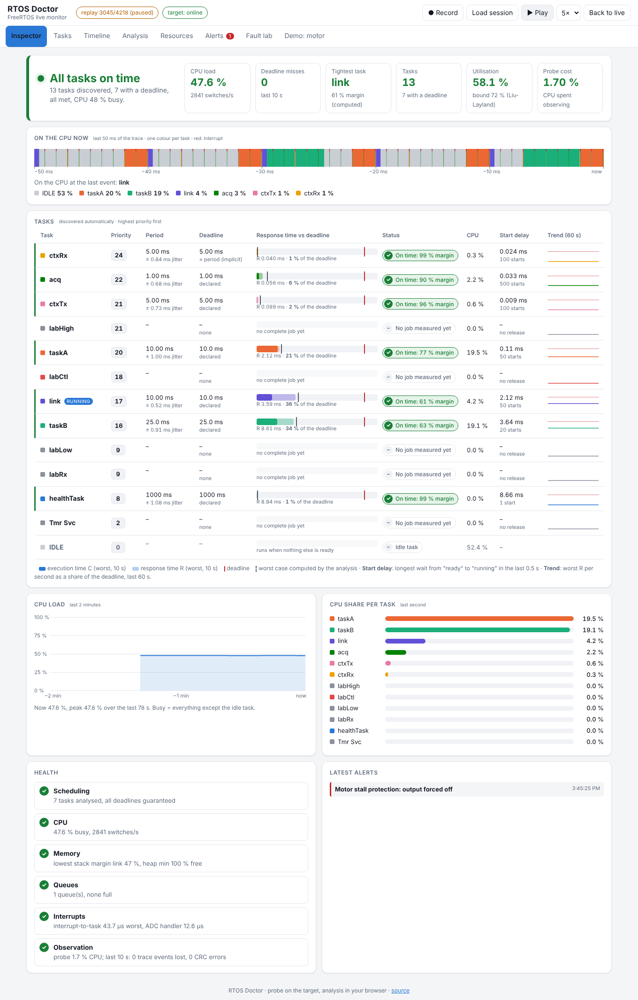
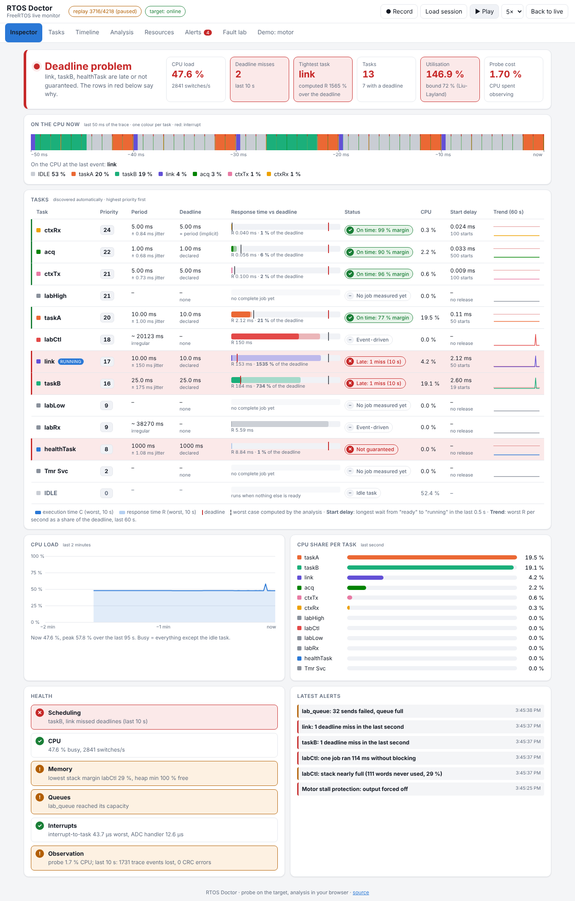
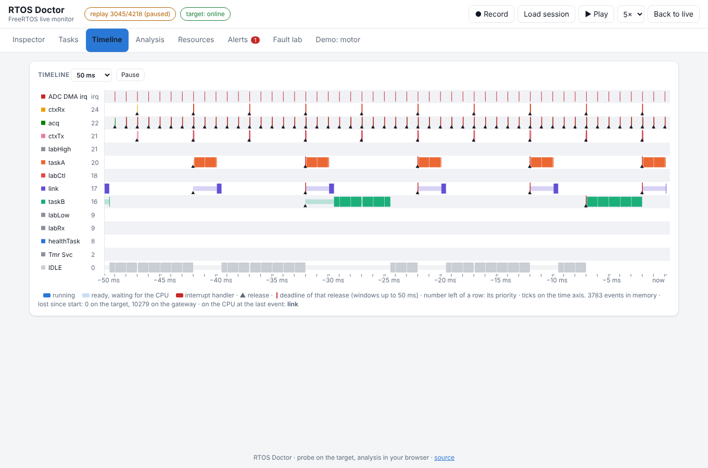
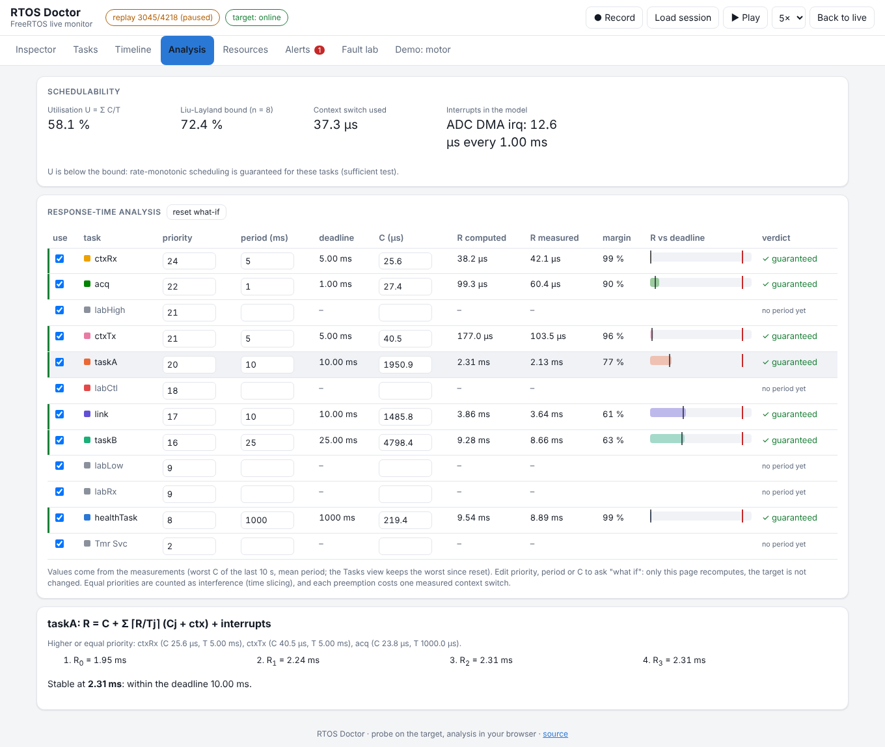
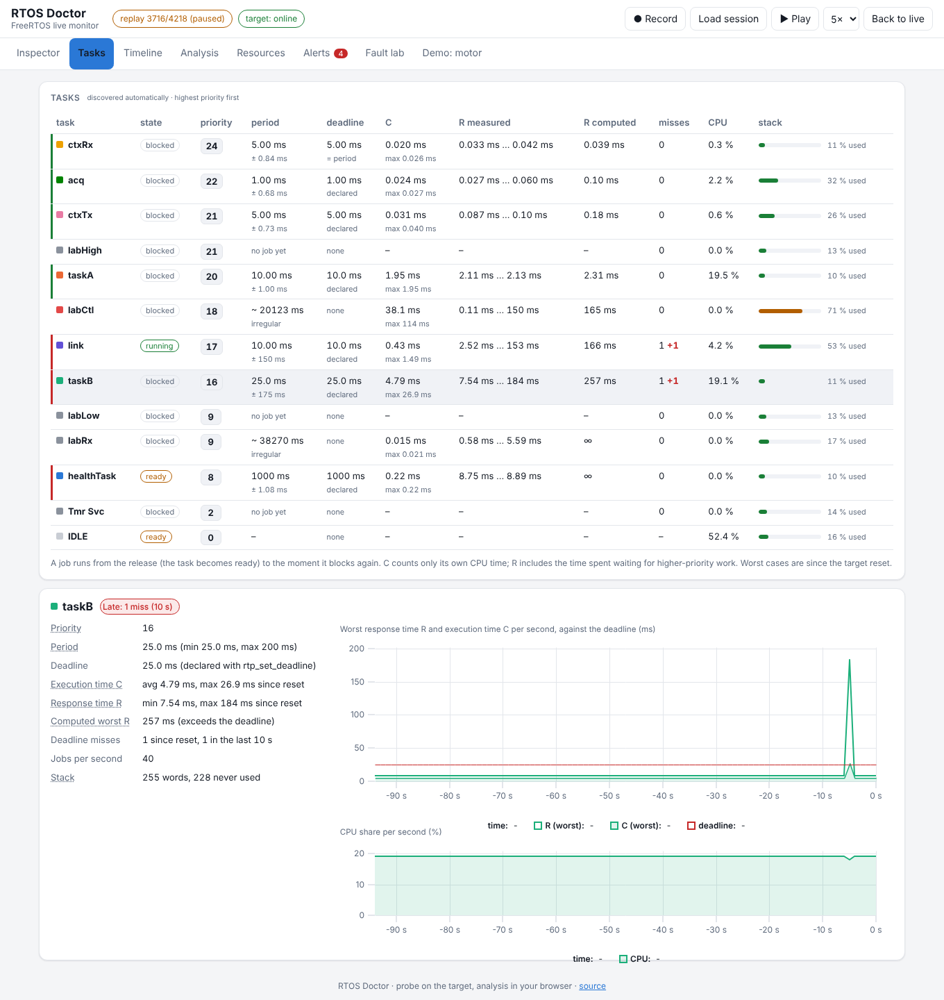
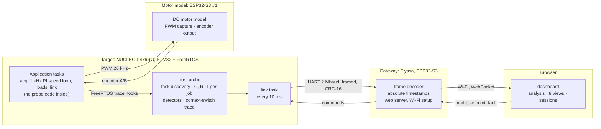
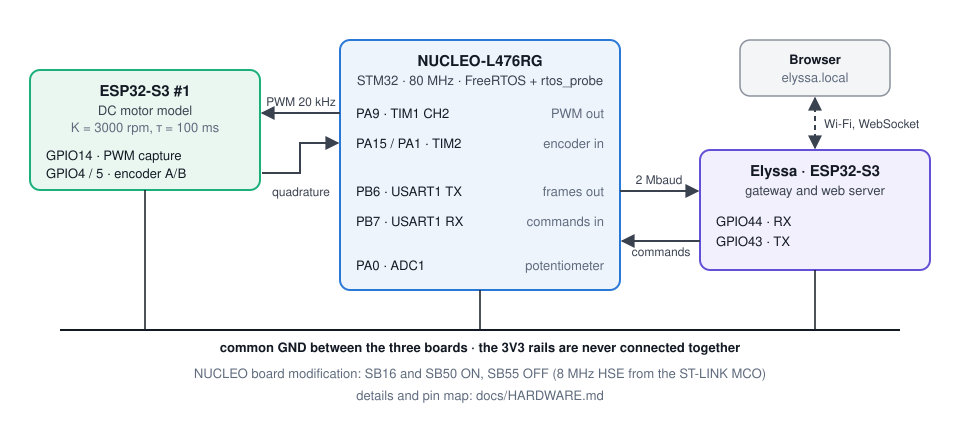
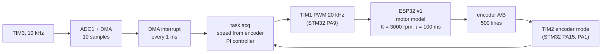
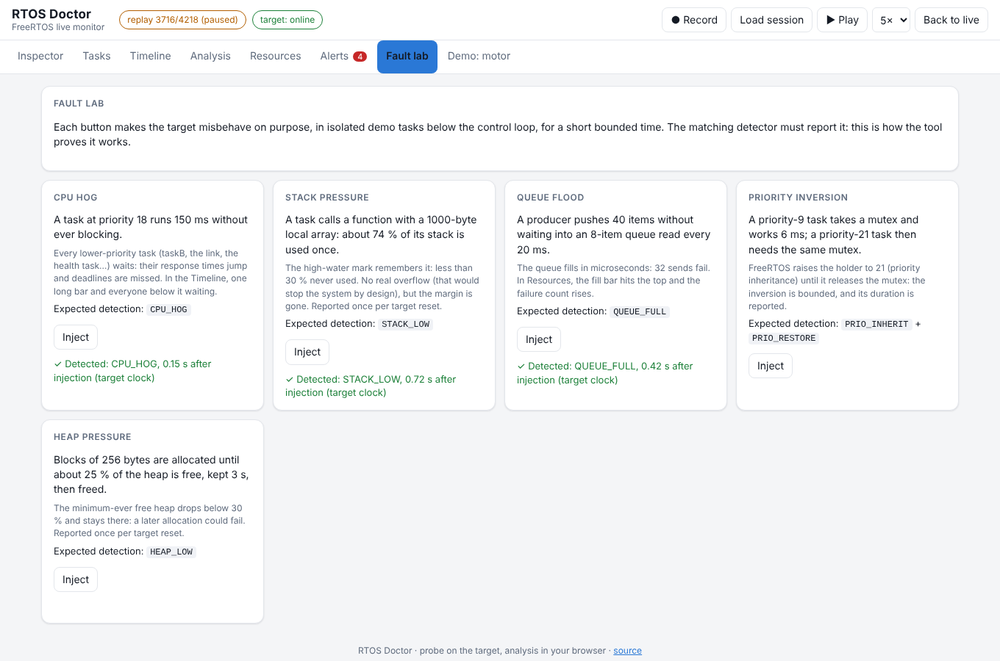

# RTOS Doctor

**A live inspector for FreeRTOS: it finds every task by itself, measures its timing on the target, checks
every deadline by calculation and by measurement, and shows the result so that anyone can read it at a glance.**
It is built and proven on a hardware-in-the-loop motor-control bench (STM32 + two ESP32-S3).

[](https://github.com/yassinechouk/freertos-hil-motor-control/actions/workflows/ci.yml)



<sub>Real session recorded on the bench (2026-10-11): 13 tasks discovered, 7 with a deadline, all on time, CPU 47.6 % busy.
The "Motor stall protection" alert is real too: the motor model was not answering during this run, and the stall protection
cut the motor as designed.</sub>

## Contents

1. [Why](#why)
2. [What you see](#what-you-see)
3. [Architecture](#architecture)
4. [How the probe measures](#how-the-probe-measures)
5. [The motor test bench](#the-motor-test-bench)
6. [Results measured on the bench](#results-measured-on-the-bench)
7. [Quick start](#quick-start)
8. [Using the probe in your own FreeRTOS project](#using-the-probe-in-your-own-freertos-project)
9. [Tests](#tests)
10. [Repository layout](#repository-layout)

## Why

An RTOS runs several tasks on one CPU and switches between them by priority. In a real-time system, a result that
comes late is a wrong result, so every periodic task has a **deadline**. Timing bugs are invisible: a task that
misses one deadline in a thousand, a stack two calls away from overflowing, a mutex that blocks a high-priority task.
Nothing crashes, nothing prints.

RTOS Doctor makes them visible. Every number it shows is either **measured on the target** or **computed from those
measurements**, with the steps shown. Its rule: *compute the timing first, then verify it by measurement.*

## What you see

The dashboard is served by the gateway and opens in any browser. The first view, **Inspector**, answers three
questions on one screen:

| Question | Where | How to read it |
| --- | --- | --- |
| Is everything fine? | the banner and the tiles | green *All tasks on time*, orange *Attention needed*, red *Deadline problem*, with the tasks named |
| What is running right now? | **On the CPU now** | the last 50 ms of the trace, one colour per task, interrupts in red, and the share of each task |
| Which task is late, and why? | the **task board** | one row per task, highest priority first (see below) |

Each row of the task board:

| Column | Meaning |
| --- | --- |
| **Priority** | the FreeRTOS priority (an arrow shows a priority inherited through a mutex) |
| **Period** | measured time between two releases, with its jitter; *irregular* or *on demand* for event-driven tasks |
| **Deadline** | declared with `rtp_set_deadline()`, or the period by default |
| **Response time vs deadline** | dark bar: execution time C · light bar: response time R (release to end, waits included) · red line: deadline · dotted line: worst case computed by the analysis |
| **Status** | *On time* with the margin, *Tight* (under 20 % margin), *Late* (misses in the last 10 s), *Not guaranteed* (the analysis says a miss is possible) |
| **CPU** | share of the last second |
| **Start delay** | longest wait from "ready" to "running" in the last 0.5 s: how long the task waited for higher-priority work |
| **Trend** | worst response time of each second over the last minute, as a share of the deadline (the red line is 100 %) |

When something goes wrong, the board says which task and by how much. Below, on the bench, the fault lab has
injected a CPU hog (a priority-18 task busy-waits 150 ms without blocking): link and taskB, below it, are late,
and the banner names them. The analysis now uses the merged 184 ms job of taskB, so utilisation reads 147 % until
that job leaves the 10 s window: the numbers say exactly what happened, they are not smoothed.



The other views go deeper:

| View | Content |
| --- | --- |
| **Tasks** | every measured value per task, and a card with curves: worst R and C per second against the deadline, CPU share |
| **Timeline** | Gantt chart rebuilt from the trace of every context switch: running, ready-and-waiting, interrupts, releases (▲) and their deadlines |
| **Analysis** | response-time analysis with the measured values, each iteration step, and "what if" editing of priority, period and C |
| **Resources** | stacks, heap, queues, interrupt latency, cost of the probe itself |
| **Alerts** | every detected problem, explained, with what to do |
| **Fault lab** | buttons that make the target misbehave on purpose; the matching detector must fire |
| **Demo: motor** | the motor bench: speed, setpoint, duty cycle, 3D motor, controls |

| Timeline | Analysis |
| --- | --- |
|  |  |



## Architecture



| Part | Role | Code |
| --- | --- | --- |
| **Probe** | runs inside the target, attached to the kernel through FreeRTOS trace macros; measures, never analyses | `firmware/Core/Src/rtos_probe.c` |
| **Link** | framed protocol `A5 5A · LEN · TYPE · SEQ · payload · CRC-16`; sequence numbers count lost frames | `protocol/hil_proto.h` |
| **Gateway** | decodes frames, turns the trace into absolute timestamps, serves the dashboard from its flash, relays commands | `supervisor/` (Arduino) |
| **Dashboard** | plain ES modules, no build step; the analysis runs here, so it can show its steps and answer "what if" | `supervisor/web/` |
| **Motor bench** | the workload the probe watches: a real 1 kHz control loop closed through real signals | `firmware/`, `esp32-motor-sim/` |

Design rules: measure on the target, analyse elsewhere; no instrumentation in the application's tasks; the gateway
observes and the target decides (commands are clamped, ramped or refused, and the motor falls back to 0 if the
operator disappears); static allocation, fail-stop faults, nothing claimed without a measurement.
More: [docs/ARCHITECTURE.md](docs/ARCHITECTURE.md).

## How the probe measures

1. **Discovery.** When FreeRTOS creates a task (idle and timer tasks included), the probe records its name,
   priority and stack, and gives it a tag. Nothing has to be registered.
2. **Jobs.** A job runs from the moment the task becomes ready (its *release*) to the moment it blocks again.
   At every context switch, a read-only look at the kernel's ready list tells *preempted* (the job goes on) from
   *blocked* (the job ends).
3. **Numbers.** Timestamps come from the DWT cycle counter (12.5 ns at 80 MHz). Per job: **C** = CPU time used,
   **R** = end − release. Per task: period and jitter, deadline misses (R > D), CPU share, stack high-water mark.
4. **Detectors**, once per second: deadline miss, CPU hog (one job ≥ 50 ms), starvation (ready 1 s without
   running), stack < 30 % free, heap < 30 % free, queue full, priority inheritance (with its duration).
5. **Trace.** Every switch, release, tick and instrumented interrupt goes into a 1024-entry ring, about 6 000
   events/s, sent every 10 ms. Losses are counted, never hidden, and the probe reports its own CPU cost.

In the browser, the **response-time analysis** computes the worst case of each task from the measured values:

    R = C + Σ over higher-or-equal priority tasks j of ⌈R / Tj⌉ · (Cj + context switch) + interrupt terms

iterated until R stops changing. A task is *guaranteed* when R ≤ D.

## The motor test bench

The bench gives the probe a real hard-real-time application to watch, closed through real electrical signals.



<!-- Photo of the cabled bench: add docs/images/bench.jpg and reference it here. -->

**The loop, every millisecond:**



- The **STM32** runs the real firmware: speed estimate from the encoder count, PI controller (gains from an
  offline simulation), setpoint ramp, stall protection (high duty and no motion for 0.5 s cuts the motor), and the
  modes IDLE, LOCAL, REMOTE and TEST. In REMOTE, the setpoint must be refreshed every second or the motor returns to 0.
- **ESP32 #1** is the motor: it measures the PWM duty, integrates a first-order DC motor model and outputs the
  quadrature encoder signals the STM32 reads back.
- The hardware does the input and output (PWM, encoder counting, ADC sampling, UART by DMA): the CPU only decides.

**The tasks of the bench firmware** (as the Inspector shows them):

| Task | Priority | Period | Deadline | What it does |
| --- | --- | --- | --- | --- |
| ctxRx | 24 | released by ctxTx | = period | wakes on a notification and measures the notify-to-wake latency |
| acq | 22 | 1 ms (DMA interrupt) | 1 ms | the control loop: ADC block, encoder, speed, PI, PWM |
| ctxTx | 21 | 5 ms | 5 ms | timestamps and notifies ctxRx (context-switch measurement) |
| labHigh | 21 | on demand | – | fault lab: victim of the priority inversion |
| taskA | 20 | 10 ms | 10 ms | synthetic load: 2 ms of CPU per period |
| labCtl | 18 | on demand | – | fault lab: runs the injected fault |
| link | 17 | 10 ms | 10 ms | link to the gateway: commands in, telemetry, statistics and trace out |
| taskB | 16 | 25 ms | 25 ms | synthetic load: 5 ms of CPU per period |
| labLow, labRx | 9 | on demand | – | fault lab: mutex holder, slow queue consumer |
| healthTask | 8 | 1 s | 1 s | free heap and stack high-water marks |
| Tmr Svc, IDLE | 2, 0 | – | – | created by FreeRTOS |

Priorities follow the periods (rate-monotonic): the shorter the period, the higher the priority.
The **fault lab** (`faultlab.c`) injects, on request and for a bounded time, a CPU hog, stack pressure, a queue
flood, a priority inversion or heap pressure, always in isolated tasks below the control loop. Each card reports
the matching detection and its delay, measured on the target clock (here, a run on the bench):



Pins and board notes: [docs/HARDWARE.md](docs/HARDWARE.md).

## Results measured on the bench

| Measurement | Predicted | Measured |
| --- | --- | --- |
| PI speed step 0 → 1500 rpm, rise time 10-90 % | 103 ms (simulation) | **103 ms**, overshoot −0.07 % |
| Motor model time constant | 100 ms | 99.5 ms |
| Notify-to-wake latency (`-O2`) | – | 6.3 to 7.0 µs |
| First run: ctxTx (5 ms) and link (10 ms) below taskB (25 ms) in priority | deadlines missed (analysis) | 7 561 and 223 misses |
| Same tasks after raising their priorities from the analysis (ctxTx 12 → 21, link 10 → 17) | R below D | 0 misses in 40 s, every measured R below the computed R |
| Link over UART at 2 Mbaud | – | 0 CRC errors, 0 lost frames |
| Fault lab, 5 injected faults | one detection each | 5 of 5 detected, 0.1 to 1.0 s after injection |
| Fault lab, run of 2026-10-11 (target clock) | – | CPU hog 0.15 s · stack pressure 0.72 s · queue flood 0.42 s |
| Cost of observing (probe hooks / kernel switching) | – | **1.7 %** / 1.3 % of the CPU, at 2 841 switches/s and 7 562 trace events/s |
| CPU load, 13 tasks, declared deadlines | utilisation 58.1 % (analysis, worst C of each task) | 47.6 % busy on average, 0 deadline misses until the injected fault |

Two logic-analyser captures from the bench: task A and task B on their timing pins (B is preempted by A: 7.01 ms
instead of 5 ms), and the motor PWM at 68 % duty, 20 kHz.

| Task A (D0) and task B (D1) | Motor PWM, 20 kHz |
| --- | --- |
| [](captures/task-b-response-timing.png) | [](captures/pwm-duty-68.png) |

Full measurement log: [docs/MEASUREMENTS.md](docs/MEASUREMENTS.md). What went wrong and what it taught:
[docs/LESSONS.md](docs/LESSONS.md).

## Quick start

**Hardware:** NUCLEO-L476RG, two ESP32-S3 boards (the motor model, and the gateway "Elyssa"), a few wires.
Wiring: [docs/HARDWARE.md](docs/HARDWARE.md).

1. **Target (STM32):** open `firmware/` in STM32CubeIDE, build (GCC `-O2`) and flash, or build from the command
   line with `tools/build_firmware.sh`.
2. **Motor model (ESP32 #1):** `esp32-motor-sim/build_flash.ps1` (builds in the `espressif/idf:v6.1` Docker image),
   or `idf.py build flash` with ESP-IDF v6.1.
3. **Gateway (Elyssa):** Arduino IDE with the "Moovma" board package, open `supervisor/supervisor.ino`, upload.
   After any change in `supervisor/web/`, run `python tools/embed_assets.py` first.
4. **Wi-Fi:** on first start the gateway opens the network **Elyssa-Setup**; join it and pick your network.
   Or type `wifi set "network" password` in its USB console.
5. Open **http://elyssa.local** (or the address printed on the console).

**Without hardware:** serve `supervisor/web/` with any web server and open
`index.html?session=<session file>` to replay a recorded session (the **Record** button saves one).

## Using the probe in your own FreeRTOS project

1. Copy `rtos_probe.c`, `rtos_probe.h`, `rtos_probe_hooks.h` (from `firmware/Core/`) and `protocol/hil_proto.h`.
2. Paste the probe block of `firmware/Core/Inc/FreeRTOSConfig.h` (trace macros and three settings) into yours.
3. Enable the DWT cycle counter, then call `rtp_init()` before creating the first task.
4. From a low-priority task, call `rtp_second()` once per second and send `rtp_trace_read()`, `rtp_task_stats()`,
   `rtp_event_pop()`... over any link (see `LinkTask` in `firmware/Core/Src/main.c`).
5. Optional: `rtp_set_deadline()`, `rtp_queue_register()`, `rtp_isr_enter()` / `rtp_isr_exit()`.

Requirements and limits: single-core Cortex-M with a DWT cycle counter (validated on a Cortex-M4), FreeRTOS 10.x, up to 15 tasks and
7 queues; the probe owns the application task tag. A task that blocks several times per cycle is seen as several
jobs, and C is the worst value observed, not a proven worst case.

## Tests

| Test | Command |
| --- | --- |
| Link protocol (host, gcc, sanitizers) | `gcc -Wall -Wextra -Werror -fsanitize=address,undefined protocol/test_proto.c -o t && ./t` |
| Response-time analysis | `node supervisor/web/tests/analysis.test.mjs` |
| Dashboard in a headless browser | `powershell -File tools/test_ui.ps1` (Docker) |
| Firmware build | `tools/build_firmware.sh` |

All of them run on every push (`.github/workflows/ci.yml`). The UI test replays a **synthetic** session made by
`supervisor/web/tests/make_fixture.py`: a small scheduler simulation of the bench task set (real priorities and
periods, assumed execution times) with a CPU hog injected at 6 s. It opens every view in light and dark mode and at
phone width, and fails on any JavaScript error. The screenshots of this README come from a session recorded on
the bench, replayed by `supervisor/web/tests/screenshots.mjs` (`SESSION=<file> HEALTHY=<s> FAULT=<s>`): record a new
session with the **Record** button and run it again to refresh them.

## Repository layout

```
firmware/          STM32 target: FreeRTOS application, rtos_probe, fault lab (STM32CubeIDE project)
esp32-motor-sim/   ESP32 #1: DC motor model, PWM capture, quadrature encoder (ESP-IDF)
supervisor/        gateway (Arduino) and the dashboard (supervisor/web)
protocol/          link protocol header (single source) and its host tests
tools/             firmware build, UI test, asset embedding, protocol sync
docs/              architecture, hardware, measurement log, lessons learned, images
captures/          logic-analyser captures from the bench
```

**Next:** publish a reference session as a replayable demo; make the gateway flush its trace buffer when full
(events are lost when its loop stalls more than 0.3 s); measure the end-to-end latency from a fault to the dashboard; hardware emergency stop (TIM1 break input), watchdog
and a long-run test.
