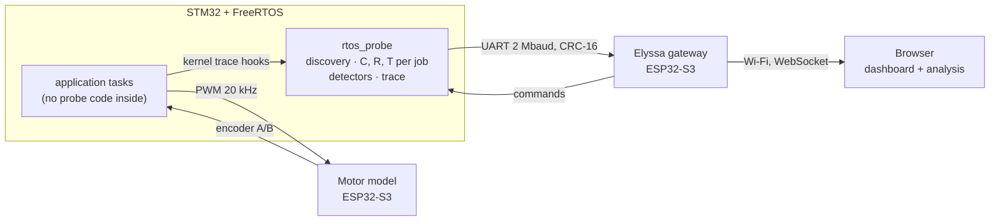
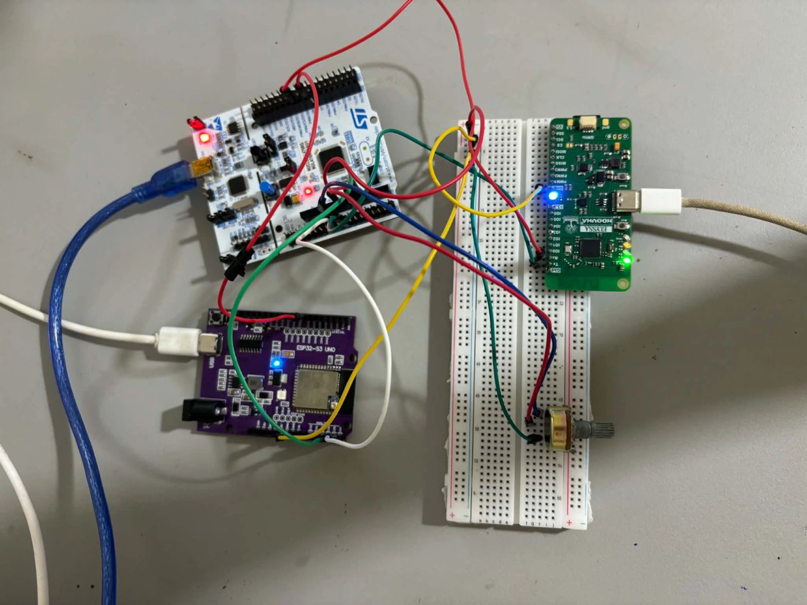
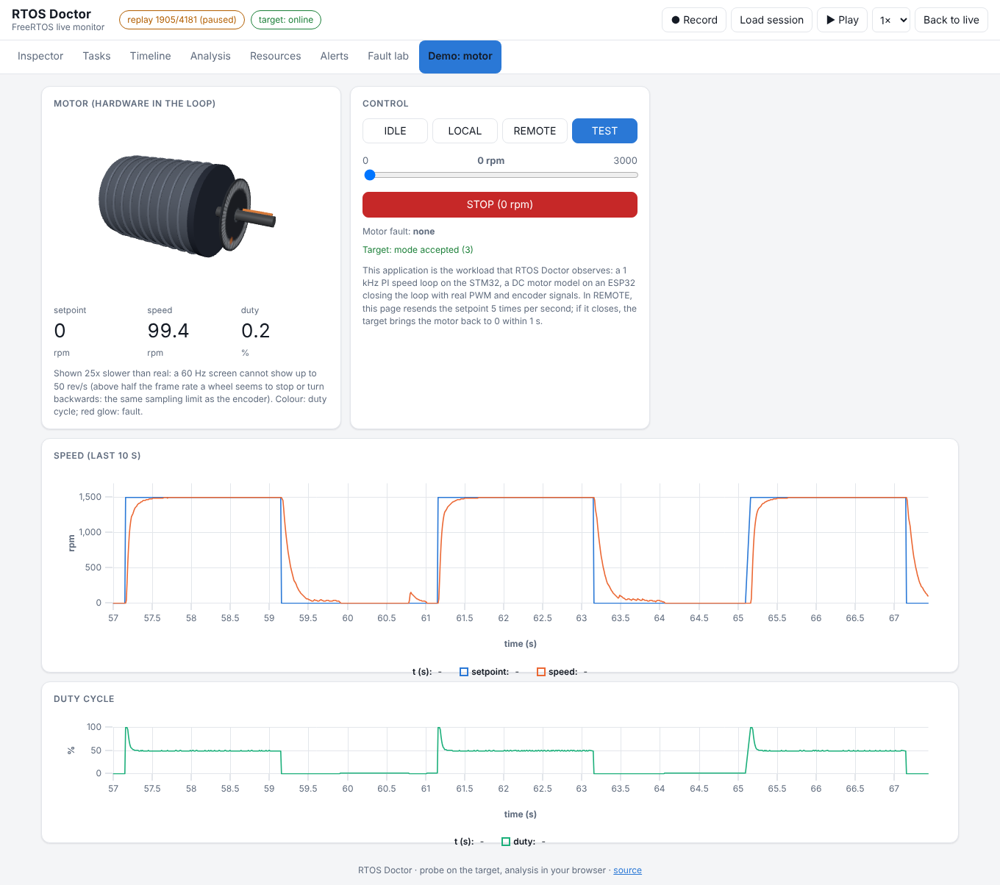

# RTOS Doctor

**A live inspector for FreeRTOS.** It finds every task by itself, measures its timing on the target, checks every
deadline by calculation and by measurement, and shows the result so that anyone can read it at a glance.
Built and proven on a hardware-in-the-loop motor-control bench (STM32 + two ESP32-S3).

[](https://github.com/yassinechouk/freertos-hil-motor-control/actions/workflows/ci.yml)


<sub>Recorded on the bench, motor running: 13 tasks discovered, all deadlines met, CPU 47.8 % busy.</sub>

## Why

An RTOS runs several tasks on one CPU, by priority. In a real-time system a late result is a wrong result, so every
periodic task has a **deadline**. Timing bugs are invisible: a deadline missed once in a thousand, a stack close to
overflowing, a mutex blocking a high-priority task. Nothing crashes, nothing prints.

RTOS Doctor makes them visible. Every number is **measured on the target** or **computed from those measurements**,
with the steps shown: *compute the timing first, then verify it by measurement.*

## What you see

The first view, **Inspector**, answers three questions on one screen:

- **Is everything fine?** A verdict (*All tasks on time*, *Attention needed*, *Deadline problem*) naming the tasks concerned.
- **What runs right now?** The last 50 ms on the CPU, one colour per task.
- **Which task is late, and why?** One row per task, highest priority first: priority, period, deadline, response
  time against the deadline, status, CPU share, start delay (time spent waiting for the CPU) and a 60 s trend.

When something goes wrong, the board says which task and by how much. Here the fault lab has injected a CPU hog
(a task running 150 ms without blocking): the two tasks below it, link and taskB, miss their deadline.


Other views: **Tasks** (all values and curves per task), **Timeline** (Gantt chart of every context switch, with
releases and deadlines), **Analysis** (response-time analysis step by step, with "what if"), **Resources** (stacks,
heap, queues, interrupts), **Alerts** (each problem explained), **Fault lab** and **Demo: motor**.


## How it works



- **Probe** (`firmware/Core/Src/rtos_probe.c`): attached to the kernel through FreeRTOS trace macros. It discovers
  every task when it is created and times every job, from its release to the moment it blocks: **C** (CPU time) and
  **R** (response time), with the DWT cycle counter (12.5 ns). Detectors: deadline miss, CPU hog, starvation,
  stack, heap, queue full, priority inheritance.
- **Gateway** (`supervisor/`): decodes the frames, serves the dashboard from its flash, relays commands.
- **Dashboard** (`supervisor/web/`): plain JavaScript, no build step. The **response-time analysis** runs here:
  `R = C + Σ ⌈R / Tj⌉ · Cj` over the higher-priority tasks, iterated until stable; a task is *guaranteed* when R ≤ D.

Details: [docs/ARCHITECTURE.md](docs/ARCHITECTURE.md).

## The motor test bench



<sub>NUCLEO-L476RG (top left), ESP32-S3 running the motor model (bottom left), Elyssa gateway (right) and the setpoint potentiometer.</sub>

The bench gives the probe a real hard-real-time application to watch. Every millisecond, the STM32 reads the
encoder, runs a PI speed controller and updates the PWM; the second ESP32 simulates a DC motor (K = 3000 rpm,
τ = 100 ms) and sends the encoder signals back. Modes: IDLE, LOCAL (potentiometer), REMOTE (from the dashboard,
with a dead-man: the motor returns to 0 if the page stops refreshing) and TEST (square wave), with stall protection.



| Task | Priority | Period | Deadline | Role |
| --- | --- | --- | --- | --- |
| ctxRx | 24 | 5 ms | = period | measures the notify-to-wake latency |
| acq | 22 | 1 ms | 1 ms | the control loop: encoder, speed, PI, PWM |
| ctxTx | 21 | 5 ms | 5 ms | wakes ctxRx (context-switch measurement) |
| taskA | 20 | 10 ms | 10 ms | load: 2 ms of CPU per period |
| link | 17 | 10 ms | 10 ms | link to the gateway: commands, statistics, trace |
| taskB | 16 | 25 ms | 25 ms | load: 5 ms of CPU per period |
| healthTask | 8 | 1 s | 1 s | heap and stack checks |
| labCtl, labHigh, labLow, labRx | 18, 21, 9, 9 | on demand | – | fault lab |

Priorities follow the periods (rate-monotonic). Wiring and pins: [docs/HARDWARE.md](docs/HARDWARE.md).

## Results measured on the bench

| Measurement | Predicted | Measured |
| --- | --- | --- |
| Speed step 0 → 1500 rpm, rise time | 103 ms (simulation) | **103 ms**, no overshoot |
| ctxTx and link with lower priorities than taskB (first version) | misses (analysis) | 7 561 and 223 misses |
| Same tasks with the priorities fixed from the analysis | R below D | **0 misses**, every measured R below the computed R |
| Fault lab: CPU hog, stack, queue flood, priority inversion, heap | 5 detections | **5 of 5**, 0.002 to 0.58 s after injection |
| Cost of the probe | – | **1.7 %** of the CPU (2 841 switches/s, 7 562 trace events/s) |
| Link at 2 Mbaud | – | 4 CRC errors in 51 886 frames, each detected and counted |

Full log: [docs/MEASUREMENTS.md](docs/MEASUREMENTS.md). Lessons learned: [docs/LESSONS.md](docs/LESSONS.md).

## Quick start

1. **STM32:** open `firmware/` in STM32CubeIDE, build and run (or `tools/build_firmware.sh`).
2. **Motor model (ESP32-S3):** `esp32-motor-sim/build_flash.ps1`, or `idf.py build flash` with ESP-IDF v6.1.
3. **Gateway (Elyssa):** Arduino IDE, board package "Moovma", open `supervisor/supervisor.ino`, upload.
4. **Wi-Fi:** join the network **Elyssa-Setup** and choose yours, then open **http://elyssa.local**.

No hardware? Serve `supervisor/web/` and open `index.html?session=<file>` to replay a session saved with **Record**.

**In your own FreeRTOS project:** copy `rtos_probe.c/.h`, `rtos_probe_hooks.h` and `protocol/hil_proto.h`, paste the
probe block of `FreeRTOSConfig.h`, call `rtp_init()` before creating the first task, and send the probe's data over
any link (see `LinkTask` in `main.c`). Requires a single-core Cortex-M with a DWT cycle counter and FreeRTOS 10.x.

## Repository

```
firmware/          STM32: FreeRTOS application, rtos_probe, fault lab
esp32-motor-sim/   ESP32-S3: DC motor model
supervisor/        Elyssa gateway and the dashboard (supervisor/web)
protocol/          link protocol and its tests
tools/             build, test and asset scripts
docs/              architecture, hardware, measurements, lessons, images
captures/          logic-analyser captures from the bench
```

Tests (run on every push): link protocol with sanitizers, response-time analysis, dashboard in a headless browser,
firmware build. See `.github/workflows/ci.yml`.
